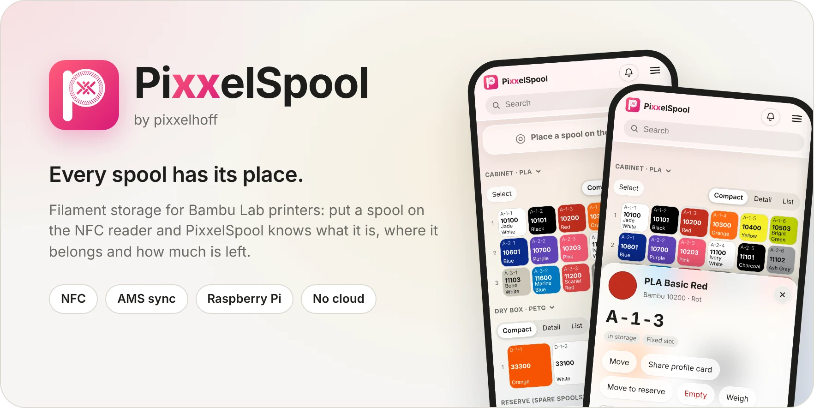
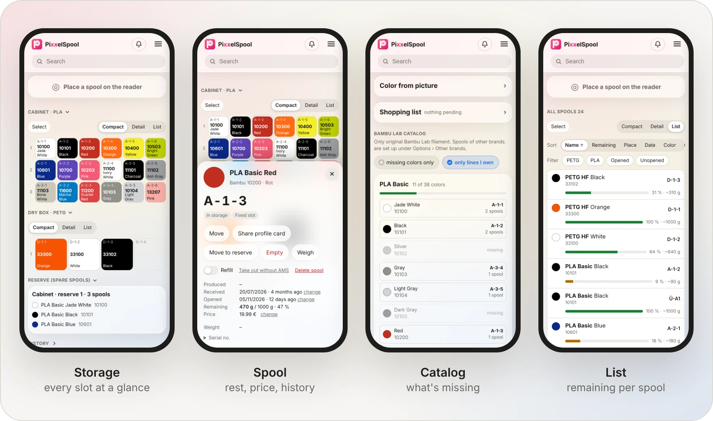
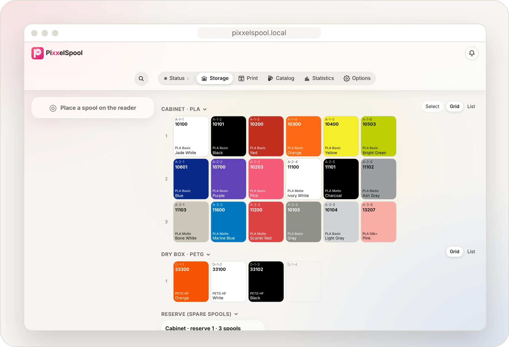

<p align="center">
  <picture>
    <source media="(prefers-color-scheme: dark)" srcset="docs/img/hero-dark.webp">
    
  </picture>
</p>

<p align="center">
  <a href="LICENSE"></a>
  
  
  
</p>

<p align="center">
  A self-hosted filament storage for Bambu Lab users. Put a spool on the NFC reader (or simply into the AMS) and
  PixxelSpool tells you what it is, where it belongs and how much is left. It syncs with your AMS, checks print jobs
  and 3MF files, and finds colors from a photo. Runs at home on a Raspberry Pi, a Mac or a Windows PC and is used
  from any browser in your home network or as an iPhone web app. No account, no cloud.
</p>

<p align="center">
  <a href="#installation"><b>Install</b></a> ·
  <a href="#what-you-need">Hardware</a> ·
  <a href="#nfc-readers">NFC readers</a> ·
  <a href="#features">Features</a> ·
  <a href="CHANGELOG.md">Changelog</a>
</p>

---

<p align="center">
  <picture>
    <source media="(prefers-color-scheme: dark)" srcset="docs/img/gal-dark.webp">
    
  </picture>
</p>

## Contents

- [Features](#features)
- [What you need](#what-you-need)
- [NFC readers](#nfc-readers)
- [Spools from other brands](#spools-from-other-brands)
- [Installation](#installation)
  - [Raspberry Pi](#raspberry-pi)
  - [Windows app](#windows-app)
  - [Mac app](#mac-app)
  - [Docker](#docker)
- [First start](#first-start)
- [Password](#password)
- [Remote access and push notifications](#remote-access-and-push-notifications)
- [Updating](#updating)
  - [Security updates](#security-updates)
- [Data and backups](#data-and-backups)
- [Troubleshooting](#troubleshooting)
- [For developers](#for-developers)
- [Support](#support)
- [License and disclaimer](#license-and-disclaimer)

## Features

### 🗄️ Storage
- Put a spool on the reader: PixxelSpool reads material, color and serial number from the Bambu Lab tag and
  suggests a slot.
- No reader at hand? The AMS works as a scanner too: when it reads a Bambu Lab spool that is not in storage yet,
  PixxelSpool asks "New spool detected" and adds it with one tap. Take it out of the AMS again and PixxelSpool shows
  its slot. A separate NFC reader is still recommended.
- Set up your own storage, e.g. a cabinet, a shelf unit or a rod on the wall: rods or levels, slots per level,
  numbering 1-2-3 or A-B-C, reserve areas without fixed slots for spare spools, a dry zone for PETG, TPU and ABS.
- Live stock and reserve, opened and sealed spools, refills (shown hatched), history per spool.
- Bulk inventory and a guided stock check, slot by slot.
- Grid view or list view: the list shows every spool with its slot and a bar for the remaining filament, sorted
  by name, remaining amount or slot.
- Multi-select in the storage view: set a price, mark as dried, move to reserve, mark as empty or delete several
  spools at once. Price, drying and reserve can be undone right afterwards.
- Other brands: create your own lines (e.g. Sunlu PETG, eSun PLA+) with colors, net weight, empty spool weight,
  price and drying settings. Add an NFC sticker and they are found by placing them on the reader like Bambu spools
  (see [Spools from other brands](#spools-from-other-brands)).
- Remaining filament with a kitchen scale: weigh the spool, PixxelSpool subtracts the empty spool.
- Printable labels for each slot in three sizes (Options › Set up storage › Print labels): storage name, slot code,
  position and a QR code (optionally with the PixxelSpool logo). Scanning a code with the phone opens that slot.
- Drying hints per material (can be switched off).

<p align="center">
  <picture>
    <source media="(prefers-color-scheme: dark)" srcset="docs/img/desk-dark.webp">
    
  </picture>
</p>

### 🖨️ Printing
- Print job check: is there enough filament in the AMS for the running print? If not, PixxelSpool points you to
  a replacement spool in your storage.
- 3MF check: reads the filaments from a Bambu Studio file, shows the amount in grams (exact for sliced files,
  estimated otherwise) and compares it with your stock.
- Project planner: combine several colors and see what you have and where it is.

### 🎨 Colors
- Color from photo (Print tab): tap points in a picture and get the closest Bambu Lab filaments (ΔE2000), filtered by PLA,
  PETG, ABS, TPU or "in stock only".
- Catalog of all original Bambu Lab colors with your stock. Tap a color to see your spools or put it on the
  shopping list.
- Shopping list in the catalog: colors you noted, colors below your minimum stock (one tap puts the missing number
  on the list), nearly empty and used-up spools.

### 📊 Statistics
- Stock value, filament per material, usage and cost per month, spending on spools, and a list of finished prints
  with grams and cost. Tap a month to see its prints; wrong entries can be removed. Enter what you paid per delivery
  (or when storing a spool); an estimated price per line covers older spools.

### 🔔 Notifications
- A notification bell in the app: print finished or failed, printer errors, not enough filament, spool almost
  empty, drying, storage climate, new versions.
- Push notifications to your phone, even when PixxelSpool is closed (see
  [Remote access and push notifications](#remote-access-and-push-notifications)). You choose which kinds are sent,
  for example "Spool taken out of the AMS" with the slot it goes back to ("PLA Matte Charcoal goes back to slot
  L-3-02") or "New Bambu Lab spool in the AMS".

### 📡 Printer connection (optional)
- Connects directly to your Bambu Lab printer on the local network (MQTT): which spool sits in which
  AMS slot (matched by the spool's serial number), remaining filament, AMS humidity, print progress, remaining
  time, and the exact grams per filament of the running job (read from the print file on the printer).
  No Bambu account, cloud or developer mode needed. Tested with the H2C.
- Live camera image in the printer card (X1 and H2 series), only while someone is watching: 1 or 5 frames per
  second as a light preview, or "Max" with every frame at full resolution. Tap the picture to open it large.
- Switch the printer light from the printer card. For now that is the only thing PixxelSpool controls on the
  printer; more controls are planned.
- Several printers: add each one under **Options › Printers and devices › Printer**. The storage view then shows a
  compact tile per printer (printing ones first; tap one for the full card), spools in an AMS are listed with their
  printer, and notifications and statistics name the printer.
- Alternatively via Home Assistant and the Bambu Lab integration.

### 🔒 Privacy
- Everything stays on your own device. Optional password, encrypted backups, logs with secrets redacted.

## What you need

| | Raspberry Pi | Windows app | Mac app | Docker |
| --- | --- | --- | --- | --- |
| Computer | Raspberry Pi (see below) | PC with Windows 10/11, 64-bit | Mac with Apple silicon (M1 or later), macOS 12 or newer | Linux server or NAS (amd64 or arm64) |
| NFC reader | USB or GPIO (PN532) | USB | USB | USB, PN532 (devices passed in) |
| Runs | around the clock, low power | while the PC is on | while the Mac is awake | around the clock |
| Status | main platform, tested the most | preview | preview | new, preview |

A Raspberry Pi is the best choice if PixxelSpool should always be reachable (push notifications, print recording,
nightly backup). The Windows and Mac apps are handy to try PixxelSpool or if your computer is on anyway.

### Raspberry Pi

Status: ✅ tested by us · ⏳ test in progress · ⚪ should work, not tested yet

| Part | Part number | Status |
| --- | --- | --- |
| Raspberry Pi 3 Model B+ (1 GB) | SC0073 | ✅ tested |
| Raspberry Pi 4 Model B (1 GB) | SC0192 | ✅ tested |
| Raspberry Pi 5 (4 GB) | SC1111 | ✅ tested |
| Raspberry Pi 4 / 5 with more memory | – | ⚪ should work |

Also needed:

| Part | Recommendation |
| --- | --- |
| Power supply | the official Raspberry Pi power supply for your model (Pi 3B+: 5 V / 2.5 A micro-USB, Pi 4: 15 W USB-C, Pi 5: 27 W USB-C) |
| microSD card | 32 GB, class A1/A2, e.g. SanDisk Extreme or Samsung EVO Plus |
| Cooling | heatsink set (Pi 4 and Pi 5: active cooler recommended) |
| NFC reader | one of the readers below |
| Case | printable case on MakerWorld (coming soon) |

## NFC readers

Bambu Lab spools carry a MIFARE Classic tag (13.56 MHz). PixxelSpool reads it with one of the readers below. The
tag sits under the Bambu Lab logo on the side of the spool, so hold that spot against the reader.
Choose your reader in the setup assistant or under **Options › NFC reader**.

**Recommended: a USB reader on a cable.** You can hold it right against the tag and read it precisely. A reader
built into the Raspberry Pi case (PN532 HAT or module on the GPIO pins) works too, but in everyday use it is less
practical: you have to bring the spool to the Pi and find the right spot on the case.

| Reader | Part number | Connection | Status | Example |
| --- | --- | --- | --- | --- |
| ACS ACR1252U (NFC Reader III) | ACR1252U-M1 | USB | ✅ tested | [Amazon](https://www.amazon.de/dp/B01KIKBYAG) |
| ACS ACR122U | ACR122U-A9 | USB | ✅ tested | [Amazon](https://www.amazon.de/dp/B00GYPIZG6) |
| PN532 board with USB-C ("PN532 V2.0 USB-C") | – | USB (serial) | ✅ tested | [Amazon](https://www.amazon.de/dp/B0H3GKGDRG) |
| ACS ACR1552U | ACR1552U-M1 | USB | ⚪ same commands as the ACR1252U | – |
| Identiv uTrust 3700 F, HID Omnikey 5022 / 5427 CK | – | USB | ⚪ should work | – |
| Waveshare PN532 NFC HAT | – | GPIO (I2C) | ✅ tested | – |
| PN532 module V3 (Elechouse, Hailege …) | – | GPIO (I2C) | ✅ tested, good range | – |

The Amazon links are examples (Amazon Germany) to show which product we tested, not a recommendation of a
specific seller, and they contain no affiliate code. The same PN532 USB-C board is sold under many brand names;
look for the PN532 chip, a USB-C port and 13.56 MHz. A printable case for it is planned.

Not suitable: readers that act as a keyboard and only "type" a number, and 125 kHz readers.
Tested another reader or computer? Please let us know in an issue or pull request.

<details>
<summary><b>Wiring and switches for the PN532 boards</b> (GPIO boards: Raspberry Pi only)</summary>

**PN532 board with USB-C:** set the switches to HSU/UART (usually both OFF) and plug it in. PixxelSpool finds the
port by itself (setting `pn532_port` to force one).

**Waveshare PN532 NFC HAT:** plugs straight onto the GPIO header, no soldering, no cables. Two settings for I2C:

- Yellow jumpers (top left): **I0 = H, I1 = L** (the table printed on the board shows the same).
- Small switch block (1–8): **5 (SCL) and 6 (SDA) ON**, all others OFF.

With its jumpers the HAT is about 11 mm high above its board, so a lid over it has to sit that much higher.

**PN532 module V3:** easiest with the pin header already soldered on; then four female-to-female jumper wires are
all you need. Set the switches to I2C: **1 = ON, 2 = OFF** (table "I2C 1 0" on the board). Without a soldered pin
header the wires do not hold; push them in at an angle only for a quick test.

| PN532 | Raspberry Pi |
| --- | --- |
| VCC | 3.3 V (pin 1) |
| GND | GND (pin 6) |
| SDA | GPIO 2 / SDA (pin 3) |
| SCL | GPIO 3 / SCL (pin 5) |

</details>

## Spools from other brands

Spools from other brands (Sunlu, eSun, Polymaker …) usually have no tag PixxelSpool can read. They still work:

1. **Create the line:** under **Options › Other brands** add the line (e.g. "Sunlu PETG") with its colors, net
   weight, empty spool weight, price and drying settings.
2. **Add the spool:** under **Options › Add spool manually** choose brand, line and color. The spool gets a slot
   like any other.
3. **Optional: stick on an NFC sticker.** Cheap NFC stickers (NTAG213 or NTAG215, 13.56 MHz, e.g. 25 mm round)
   turn any spool into one PixxelSpool recognizes. Stick it on the side of the spool, place it on the reader and
   pick the spool from the list, or open the spool and tap **Add tag**. From then on it behaves like a Bambu spool:
   place it on the reader to store it, take it out or see its details. A sticker can be removed from a spool again
   (**Remove sticker tag**) and used for another one.

Without a sticker the spool is simply managed by hand: tap its slot in the storage view.

**In the AMS** (experimental): the AMS can't tell which spool without a Bambu Lab tag it holds. Such an AMS slot
shows **β Assign spool**: pick the spool from your storage, and PixxelSpool counts the grams of finished prints
off its remaining amount (an estimate from the print file; weighing corrects it). AMS slots only, not the external
spool holder.

## Installation

Choose your platform. All four have the same interface, the same setup assistant and share one version number.

### Raspberry Pi

1. **Prepare the card:** write Raspberry Pi OS Lite (64-bit) to the microSD card with the
   [Raspberry Pi Imager](https://www.raspberrypi.com/software/). In the Imager settings, set a hostname
   (e.g. `pixxelspool`), user, Wi-Fi and SSH.
2. **Connect the reader** (see above) and boot the Pi.
3. **Log in via SSH and install:**

   ```bash
   sudo apt-get install -y git
   git clone https://github.com/pixxelhoff/pixxelspool.git ~/pixxelspool
   cd ~/pixxelspool
   ./install.sh
   ```

   An assistant guides you through the setup: language, PN532 board, Wi-Fi fix, remote access and port. It then
   installs all packages, sets up permissions for the reader and for shutting down, and starts PixxelSpool as a
   service with a daily backup, with a progress bar. It asks for your password once (sudo). At the end it shows
   the address and a QR code for your phone. Running it again on an existing installation keeps the service name,
   port and all data.
4. **With a PN532 board, reboot once** so I2C becomes active: `sudo reboot`

`install.sh` options: `--lang en|de|es` (interface language, otherwise you are asked), `--port 8080` (different
port; default 80, or 8000 if 80 is taken), `--no-i2c` (USB reader only), `--no-wifi-fix` (keep Wi-Fi power saving on), `--remote` / `--no-remote`
(Tailscale), `--no-os-updates` (no automatic security updates of the system), `--plain` (no assistant, text output only), `--yes` (ask nothing, use defaults). The full log is
written to `install.log`.

Good to know:
- Please shut the Pi down via **Options › Raspberry Pi › Shut down** before unplugging it, and wait until the green
  LED is off.

### Windows app

PixxelSpool runs as a normal Windows app (Windows 10/11, 64-bit). The Windows app is a preview and not yet tested as
thoroughly as the Pi version.

1. **Download** `PixxelSpool-Setup-<version>.exe` from the [releases](../../releases) (under "Assets" of the
   newest version).
2. **Run the setup.** It installs for your user only, no admin rights needed. The app is not signed yet, so Windows
   SmartScreen may show "Windows protected your PC": click **More info**, then **Run anyway**. This is only needed
   once per version.
3. **Start:** PixxelSpool starts in the background with an icon in the notification area (next to the clock) and
   opens in its own app window (Microsoft Edge in app mode, no address bar; `http://localhost:8000` works in any
   browser too). The installer puts a shortcut on the desktop.
4. **Firewall:** when Windows asks, allow access in private networks if phones in your home network should connect.
   The tray menu shows the address for the phone.

Good to know:
- Reader: USB readers that speak PC/SC, e.g. the ACR122U, work without extra software. If Windows does not set one
  up by itself, install the driver from ACS. The PN532 board with USB-C works too (switches on HSU/UART);
  PixxelSpool finds the port by itself (setting `pn532_port` to force one). Built-in laptop smart card readers are
  ignored. GPIO boards (PN532 HAT, PN532 V3) need a Raspberry Pi.
- Phone access, push notifications, print recording and the nightly backup only work while the PC is on.
- Tray icon: double-click opens PixxelSpool. Right-click menu: open, phone address, GitHub, check for updates,
  reset password, start with Windows, restart, quit.
- Uninstall via Windows Settings › Apps. You are asked whether to delete your data too (default: keep).

### Mac app

PixxelSpool also runs as a Mac app (macOS 12 or newer, Mac with Apple silicon: M1 or later; Intel Macs are not
supported). Like the Windows app it is a preview and not yet tested as thoroughly as the Pi version.

1. **Download** `PixxelSpool-<version>-macos.dmg` from the [releases](../../releases) (under "Assets" of the newest
   version).
2. **Install:** open the `.dmg` and drag PixxelSpool onto the **Applications** folder.
3. **Allow the first start.** The app is not signed by a registered Apple developer yet, so macOS blocks it once:
   - **macOS 14 (Sonoma) or older:** in the Applications folder, right-click (or Control-click) PixxelSpool ›
     **Open**, then click **Open** again in the dialog.
   - **macOS 15 (Sequoia) or newer:** double-click PixxelSpool and close the warning with **Done**. Then open
     **System Settings › Privacy & Security**, scroll down to the note "PixxelSpool was blocked", click
     **Open Anyway** and confirm with your Mac password or Touch ID.
   - If macOS says the app "is damaged and can't be opened", it is not damaged; macOS only blocks apps from
     unknown developers this way. Open the **Terminal** app, run this command once and start PixxelSpool again:

     ```bash
     xattr -dr com.apple.quarantine /Applications/PixxelSpool.app
     ```

   This is only needed for the first start and again after each update.
4. **Start:** PixxelSpool runs in the background with an icon in the menu bar at the top of the screen (no Dock icon)
   and opens in your default browser (if that is Google Chrome or Microsoft Edge, in its own window without address
   bar; `http://localhost:8000` works in any browser too).
5. **Allow network access:** confirm the request to find devices in your local network (needed for the printer) and,
   if the macOS firewall is on, incoming connections (needed for phones).

Good to know:
- Reader: USB readers that speak PC/SC, e.g. the ACR122U, work without a driver. The PN532 board with USB-C works
  too (switches on HSU/UART). GPIO boards (PN532 HAT, PN532 V3) need a Raspberry Pi.
- Phone access, push notifications, print recording and the nightly backup only work while the Mac is awake.
- Menu bar icon: open, phone address, GitHub, check for updates, reset password, open at login, restart, quit.
- To remove PixxelSpool, quit it in the menu bar and move the app to the Trash. Your data stays in
  `~/Library/Application Support/PixxelSpool` (delete that folder too if you want to remove everything).

### Docker

PixxelSpool also runs as a Docker image for amd64 and arm64: on a home server, a NAS or a Raspberry Pi that runs Docker
anyway. Like the apps it is a preview.

1. **Get the compose file:** download [docker-compose.yml](docker-compose.yml) into a new folder, e.g. `~/pixxelspool`.
2. **NFC reader (optional):** in `docker-compose.yml`, remove the `#` in front of `devices:` and the line of your reader
   (USB reader, PN532 with USB-C or PN532 on the Pi pins).
3. **Start:**

   ```bash
   cd ~/pixxelspool
   docker compose up -d
   ```

4. **Open** `http://<address of the computer>:8000` in the browser. The setup assistant guides you through the rest.

Good to know:

- All data lives in the `data` folder next to `docker-compose.yml` (mounted as `/data`). Keep it when you update or
  move; a backup ZIP from another platform can be restored there too.
- The compose file uses the host network (Linux), so PixxelSpool finds the printer and your phone reaches it directly.
  On Docker Desktop (Mac/Windows) remove `network_mode: host` and use the `ports` lines instead.
- **Updating:** `docker compose pull && docker compose up -d`. PixxelSpool tells you about new versions in the bell;
  the image tags are the version (e.g. `1.0.0-beta.4`), `beta` for the newest pre-release and later `latest`.
- **Restart** under Options › System works through the restart policy (`restart: unless-stopped`).
- USB readers (ACR122U, ACR1252U): the image brings its own PC/SC service. If the computer itself runs `pcscd`, stop it
  (`sudo systemctl disable --now pcscd.socket pcscd`), and on Linux block the kernel driver that grabs the ACR122U:
  `echo "blacklist pn533_usb" | sudo tee /etc/modprobe.d/no-pn533.conf` (then reboot).
- Not in the Docker version: shutting down the computer, Tailscale setup, the power-loss notice and installing updates
  from the interface.

## First start

- **Raspberry Pi:** open `http://pixxelspool.local` in your browser (replace `pixxelspool` with your hostname from
  step 1; if port 80 was taken during the installation, add `:8000`). The end of `install.sh` also shows the IP
  address and a QR code.
- **Windows and Mac:** PixxelSpool opens by itself. On your phone, use the address from the tray or menu bar icon
  ("phone address", e.g. `http://192.168.1.20:8000`).

The setup assistant walks you through:

1. **NFC reader:** choose it and test it with a spool. Nothing is booked into your stock during the test. Without a
   reader you can skip this step and use the AMS as a scanner.
2. **Storage:** one or more storage units (cabinet, shelf unit, rod …) with levels, slots and numbering.
3. **Printer** (optional): IP address, serial number and LAN access code, all shown on the printer's display
   (Settings › Network and Settings › Device).
4. **Home Assistant** (optional, only needed without a direct printer connection): address and a long-lived
   access token (Home Assistant › Profile › Security).

At the end, the bulk inventory helps you add the spools you already have. On an iPhone, choose "Share › Add to
Home Screen" in Safari and PixxelSpool starts like an app. You can run the assistant again under **Options ›
System** (the section is called "Raspberry Pi" on the Pi and "PixxelSpool" in the apps).

## Password

Optional, off by default: **Options › System › Password**. After that PixxelSpool only opens after entering the
password; each device stays signed in for 30 days and scanning at the reader keeps working. The password is stored
only as a secure hash.

When you set it, PixxelSpool shows a recovery code once: write it down or print it. Forgot the password? Use
"Forgot password?" on the sign-in screen with the recovery code, or remove the password on the device itself:

- **Raspberry Pi:** `cd ~/pixxelspool && .venv/bin/python -m filament_tool.auth reset`
- **Windows app:** right-click the PixxelSpool icon next to the clock › **Reset password**
- **Mac app:** click the PixxelSpool icon in the menu bar › **Reset password**

Your data stays as it is. No mail server needed. The reset also removes all passkeys.

**Passkeys (optional):** while the password is on, **Options › System › Password › Add passkey** lets you sign in with
fingerprint, face or the device PIN. You can add several (one per device) and remove them again; the password and the
recovery code keep working. Browsers only allow passkeys on a secure address, so use the HTTPS address of remote access
(`https://<name>.ts.net`, see below). On a plain `http://….local` or IP address the passkey button is hidden. A passkey
only works on the address it was added on.

Wrong guesses are slowed down: after 5 wrong attempts within 15 minutes (password or recovery code, all devices
together) PixxelSpool checks no attempt for 30 seconds, after each further wrong one twice as long, at most
15 minutes. Devices that are signed in stay signed in, and the reset on the device itself always works.

**With remote access (Tailscale) a password is strongly recommended:** every device in your Tailscale network, and
everyone you share it with, can open PixxelSpool. **Options › Remote access** reminds you while no password is set.

## Remote access and push notifications

PixxelSpool can be reached on the go through [Tailscale](https://tailscale.com), a private VPN that is free for
personal use. Only your own devices get in, and nothing has to be opened on your router. Even with a password,
never expose PixxelSpool to the internet directly (no port forwarding).

1. **Install Tailscale where PixxelSpool runs:**
   - Raspberry Pi: run the installer with `--remote` (or answer “y” when it asks). It installs Tailscale and allows
     PixxelSpool to control it.
   - Windows or Mac: install [Tailscale for Windows](https://tailscale.com/download/windows) or
     [Tailscale for Mac](https://tailscale.com/download/mac) and sign in.
2. In PixxelSpool open **Options › Remote access** and sign in once if asked (Google, Apple, GitHub or Microsoft).
3. Allow HTTPS once in your Tailscale account: open [login.tailscale.com/admin/dns](https://login.tailscale.com/admin/dns),
   make sure **MagicDNS** is on and click **Enable HTTPS** under **HTTPS Certificates** (it is off by default).
4. Click **Turn on HTTPS address**. PixxelSpool shows the address (e.g. `https://pixxelspool.your-tailnet.ts.net`)
   and a QR code.
5. On your phone install the Tailscale app, sign in with the same account, scan the QR code and add the page to
   your home screen.

If Tailscale asks you to allow HTTPS certificates first, PixxelSpool shows the link to the right page in your
Tailscale account.

**Push notifications:** open PixxelSpool on your phone via the HTTPS address (on an iPhone: from the home screen),
then **Options › Push notifications › Turn on for this device**. Bell notifications such as "print finished",
printer errors or "spool almost empty" then arrive as messages, even when the app is closed and Tailscale is off on the
phone. They are end-to-end encrypted and delivered through your phone's push service (Apple, Google, Mozilla); the
keys stay in `push.json` in PixxelSpool's data folder. You choose which kinds of notifications are sent.

## Updating

PixxelSpool checks GitHub once a day and shows new versions in the notification bell, together with what changed.
Your data is kept with every update.

- **Raspberry Pi:** **Options › System › Updates › Install update** backs up the database and the current version
  first, then replaces the program files and restarts. If something goes wrong, you can go back to an earlier
  version in the same place. You can also update by hand:

  ```bash
  cd ~/pixxelspool && git pull && ./install.sh
  ```

  Run `./install.sh` again after an update when the [CHANGELOG.md](CHANGELOG.md) or PixxelSpool itself says so
  ("refresh the setup", e.g. new system packages).
- **Windows app:** the app links to the new installer; download it and run it over the old version.
- **Mac app:** the app links to the new `.dmg`; open it and drag PixxelSpool into Applications again (replace).
  Allow the first start again as described [above](#mac-app).
- **Docker:** `docker compose pull && docker compose up -d` in the folder with your `docker-compose.yml`.

### Security updates

- **Checked downloads:** every version on GitHub comes with a SHA-256 checksum. The updater on the Pi only installs
  a download whose checksum matches; the Windows and Mac downloads have a `.sha256` file next to them as well.
- **Automatic security updates (Raspberry Pi):** **Options › System › Updates › Install security updates
  automatically** (on by default). Once a day PixxelSpool looks for a version that is marked as a security release
  (a “Security” part in the changelog) and installs it by itself, with the same backups as a normal update. Normal
  updates still wait for you. If a new version fails to start twice in a row, PixxelSpool goes back to the version
  before by itself and tells you in the notification bell.
- **Windows and Mac app:** they never update silently. A security release shows up in the notification bell with
  the download.
- **The Pi's system:** the installer turns on automatic security updates of Raspberry Pi OS (security fixes from
  Debian only, the Pi never restarts by itself; switch it off with `--no-os-updates`). PixxelSpool never runs
  `sudo` itself. To turn them on later, run this once on the Pi; **Options › Raspberry Pi** shows the system version,
  whether this is on, and the command to copy:

  ```bash
  cd ~/pixxelspool && ./install.sh --os-updates
  ```

  A restart now and then (`sudo reboot`) activates kernel fixes.
- **New major version of Raspberry Pi OS** (e.g. Bookworm to Trixie): rather set the Pi up fresh with the
  [Raspberry Pi Imager](https://www.raspberrypi.com/software/), install PixxelSpool and restore your backup
  (**Options › Backup**) than upgrading the system in place. If you do upgrade in place, run `./install.sh` again in
  the PixxelSpool folder afterwards: it sets up the Python environment anew when the Python version changed.

## Data and backups

- All data stays on your own device. PixxelSpool only goes online to look for updates on GitHub (can be turned off)
  and, with a connected printer, to load the explanations for printer errors from Bambu Lab. The data folder holds the database
  `inventory.db`, `settings.json`, `bambu.json` with the printer access code and `homeassistant.json` with the
  Home Assistant token:

  | Platform | Data folder |
  | --- | --- |
  | Raspberry Pi | `~/pixxelspool/data` (excluded from the repository) |
  | Windows app | `%APPDATA%\PixxelSpool` |
  | Mac app | `~/Library/Application Support/PixxelSpool` |
  | Docker | `data` next to `docker-compose.yml` (`/data` in the container) |

- Every night at 3:30 PixxelSpool saves a backup to `backups/` in the data folder (kept 30 days, adjustable). It
  also saves a copy before updates and before risky actions such as deleting a spool or changing the storage. In the
  apps the nightly backup runs while the computer is on, or soon after the next start.
- Under **Options › Backup** you can download everything as a ZIP file, optionally protected with a password
  (`.pspbackup`, encrypted), or restore a backup: one of the automatic ones (with date and reason) or a downloaded
  file. This is also how you move to a new device, for example from the Windows app to a Raspberry Pi.
- Under **Options › Network backup** PixxelSpool also uploads the nightly backup to an SMB share (NAS, Fritzbox,
  Windows) or an FTP/FTPS server and keeps the newest copies. The password stays in `offsite.json` in the data folder.
  The uploaded backups contain no credentials. They can be protected with a password; prefer SMB or FTPS, as plain
  FTP sends everything unencrypted.

## Troubleshooting

| Problem | Solution |
| --- | --- |
| Page not reachable from the phone | Phone and PixxelSpool in the same Wi-Fi? Try the IP address. Windows/Mac: allow PixxelSpool in the firewall, and the computer must be on (Mac: awake). |
| Pi: page not reachable | Is the Pi on the same Wi-Fi? Try the IP address instead of `pixxelspool.local` (shown at the end of `install.sh`). |
| Pi: `pixxelspool.local` not found | Some Wi-Fi systems (e.g. with mDNS reflection) make the Pi think its name is taken, so it calls itself `pixxelspool-2.local`. `install.sh` shows the real address; `sudo systemctl restart avahi-daemon` usually brings the plain name back. |
| Mac: "PixxelSpool can't be opened" or "is damaged" | See [Mac app](#mac-app), step 3. |
| Windows: "Windows protected your PC" | Click **More info › Run anyway** (the app is not signed yet). |
| Reader disconnected (PN532 on the Pi) | Switches/jumpers set to I2C? Rebooted after installing? `i2cdetect -y 1` must show `24`. |
| Reader disconnected (USB) | Unplug and replug the reader. Windows: install the ACS driver if needed. Pi: run `pcsc_scan` to see whether the reader is detected. |
| PN532 USB-C board not found | Switches set to HSU/UART (usually both OFF)? |
| Tag not readable | Place the spool steadily, with the Bambu Lab logo on the reader (the tag sits underneath). Spools from other brands without a Bambu Lab tag are not recognized (use an NFC sticker). |
| Printer not connected | Printer and PixxelSpool on the same network? IP address current (DHCP may change it)? Access code changes when you reset it on the printer. Mac: allow access to the local network. |
| Home Assistant error | Check the address including `http://` and port, create a new token and enter it under Options. |

Logs: **Options › System › Log** shows recent messages and exports them as a text file (access codes, tokens and
passwords are redacted), handy for bug reports. The file lives in `logs/` in the data folder; on the Pi you can also
follow it with `journalctl --user -u pixxelspool -f`.

## For developers

```bash
python3 -m venv .venv && .venv/bin/pip install -r requirements.txt
FILAMENT_MOCK=1 .venv/bin/python run.py      # without a reader, opens http://localhost:8000
```

| File | Purpose |
| --- | --- |
| `filament_tool/main.py` | web server (FastAPI), REST API, live updates via server-sent events |
| `filament_tool/db.py` | SQLite schema, migrations, shelf layout |
| `filament_tool/logic.py` | storage logic: scan, slot suggestion, swap, reserve, reorganizing |
| `filament_tool/reader.py` | NFC readers: USB via PC/SC (pyscard) or PN532 via I2C |
| `filament_tool/bambu_tag.py` | decrypting and decoding Bambu Lab tags |
| `filament_tool/bambu.py` | direct printer connection: MQTT status, print file via FTPS |
| `filament_tool/camera.py` | printer camera (RTSPS) as small JPEG frames |
| `filament_tool/homeassistant.py` | cabinet climate sensors from Home Assistant, AMS sync with the stock |
| `filament_tool/threemf.py` | 3MF analysis |
| `filament_tool/insights.py` | shopping list, usage, drying hints |
| `filament_tool/settings.py` | settings including shelves and reader |
| `filament_tool/notices.py` | notification bell: printer, print job, stock and climate checks |
| `filament_tool/push.py` | Web Push to phones (RFC 8291 encryption, VAPID) |
| `filament_tool/host.py` | platform: Pi service, Windows app, Mac app, Docker or desktop (data folder, restart, features) |
| `filament_tool/winapp.py` | Windows and Mac app: tray / menu bar icon, single instance, autostart |
| `windows/` | PyInstaller spec and Inno Setup script; built by `.github/workflows/windows.yml` |
| `macos/` | PyInstaller spec (PixxelSpool.app) and disk image script; built by `.github/workflows/macos.yml` |
| `filament_tool/logs.py` | log viewer: in-memory buffer, rotating file, redaction of secrets |
| `filament_tool/brands.py` | custom brands and colors, prices, deliveries, weighing |
| `filament_tool/stats.py` | statistics tab: stock value, usage, cost, recorded prints |
| `filament_tool/hms.py` | printer error texts from Bambu Lab |
| `filament_tool/remote.py` | remote access via Tailscale |
| `filament_tool/offsite.py` | backup to SMB shares or FTP/FTPS |
| `filament_tool/updater.py` | updates and rollback from GitHub releases (SHA-256 checked), automatic security updates |
| `filament_tool/guard.py` | goes back to the previous version when an update does not start (Pi) |
| `tools/dev/update_test.py` | offline test of the updater and the update guard against a fake GitHub |
| `.github/workflows/pi.yml` | package and checksum for the Pi's updater, for every tag |
| `Dockerfile`, `docker-compose.yml`, `docker/` | Docker image; built for amd64 and arm64 and pushed to ghcr.io by `.github/workflows/docker.yml` |
| `.github/workflows/dependabot-security.yml` | tests, merges and releases Dependabot security updates by itself |
| `filament_tool/static/` | user interface (HTML, JavaScript, CSS), no build step |
| `filament_tool/locales/` | translations (`de.json`, `es.json`; key = English source text) |
| `tools/i18n.py` | lists missing translations |
| `install.sh` | setup on the Raspberry Pi |

Code, comments and logs are in English. Texts shown to users are written in English in the code and translated
through `filament_tool/locales/`; run `python3 tools/i18n.py` after changing them.

Versions follow [SemVer](https://semver.org/): new feature = MINOR, bug fix = PATCH. For every release, update
`VERSION`, `filament_tool/__init__.py` and `CHANGELOG.md` and add a tag `vX.Y.Z`.

## Translations

Texts in the code are written in English and translated via `filament_tool/locales/<lang>.json` (German and Spanish),
where each key is the English text and `{0}`, `{1}` are placeholders. Run `python3 tools/i18n.py` to see what is missing. To add a
language, add a JSON file and the language code in `settings.py` (`LANGS`) and in the language selector.

## Support

PixxelSpool is free. If it helps you, you can support it with a small donation on
[GitHub Sponsors](https://github.com/sponsors/pixxelhoff) or [Ko-fi](https://ko-fi.com/pixxelhoff).
The app shows a short note about it once after two hours of use; after that it is only in **Options › About**.
Every donation goes completely into the project, for these goals:

1. The Apple developer license (99 € a year), so the Mac app opens without a security warning and apps for iPhone and iPad
   (iOS and iPadOS) become possible
2. A Bambu Lab A1 mini (about 200–250 €) to test with a second printer and the AMS lite
3. A printer from another brand (about 300–400 €)

## License and disclaimer

Copyright (C) 2026 pixxelhoff. The source code is released under the
[GNU Affero General Public License v3.0](LICENSE) (AGPL-3.0). You may use, change and share it freely. If you
distribute a modified version or offer it as a service over a network, you must publish its source code under
AGPL-3.0 as well.

The names "PixxelSpool" and "pixxelhoff" and their logos are not covered by the license and may not be used for
derived projects or products; see [NOTICE](NOTICE). Contributions are welcome, see [CONTRIBUTING.md](CONTRIBUTING.md).
Please report bugs and ideas via the [issue templates](https://github.com/pixxelhoff/pixxelspool/issues/new/choose)
and security issues privately, see [SECURITY.md](SECURITY.md).

PixxelSpool is an independent hobby project. It is not affiliated with, endorsed by or sponsored by Bambu Lab.
"Bambu Lab", "AMS" and the names of Bambu Lab filaments are trademarks of their respective owners and are used
only to describe compatibility. Color names and numbers in the included catalog are for identification only.
PixxelSpool only reads spool tags; it never writes or changes them. Use at your own risk.

Key derivation and tag layout based on the
[RFID Tag Guide by the Bambu Research Group](https://github.com/Bambu-Research-Group/RFID-Tag-Guide).
